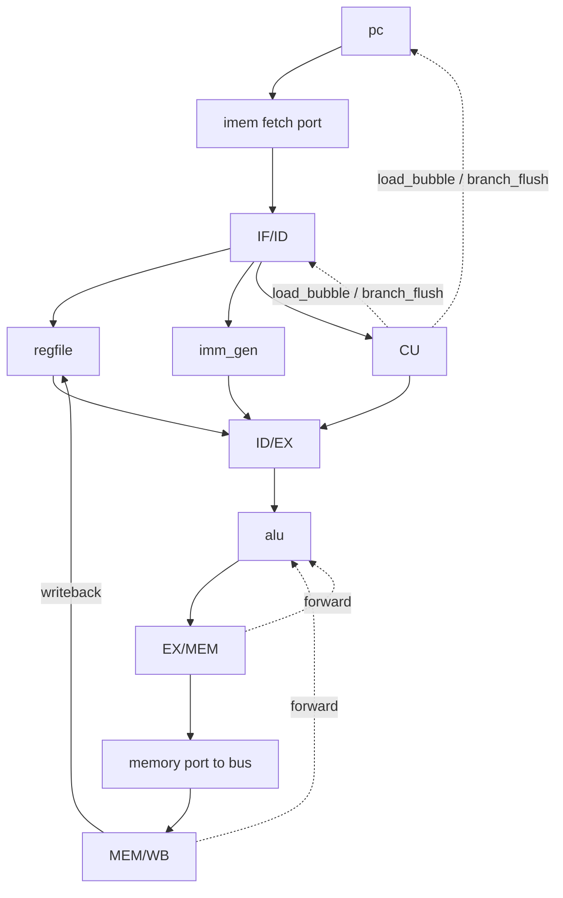
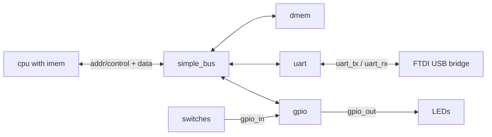
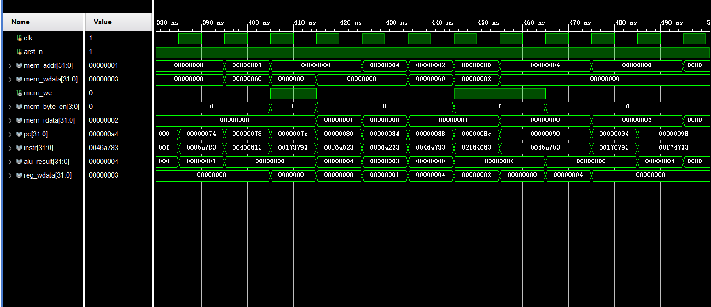
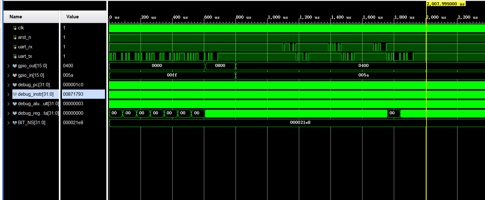

# rv32i_min_cpu

**A 5-stage pipelined RV32I CPU in Verilog**, plus a minimal SoC around it:
instruction/data memory, a peripheral bus, a UART and GPIO. It is not a block design or a
vendor soft core — the datapath, hazard control and every peripheral are explicit RTL, and
the **same SoC boots and runs real compiled C programs** in simulation and on a Digilent
Basys 3 FPGA.

- **ISA:** RV32I (`-march=rv32i -mabi=ilp32`), word and byte loads/stores (`lw/sw`, `lb/lbu/sb`)
- **Pipeline:** load-use stall, branch/jump flush, EX/MEM and MEM/WB forwarding
- **Peripherals:** polled UART (TX and RX) and GPIO direction/output/input
- **Board:** Digilent Basys 3 (Artix-7) — 8 switches in, LEDs out, one USB for JTAG and UART

## 1. Architecture

The CPU is a classic five-stage pipeline (IF / ID / EX / MEM / WB). `imem` lives inside the
CPU and has two read ports; the CPU reaches data memory and peripherals through one memory
port driven by `simple_bus`.



The SoC adds the bus and the peripherals:



**File layout**

```
rtl/core     cpu, pc, imem, dmem, regfile, alu, CU, imm_gen
rtl/bus      simple_bus
rtl/periph   uart, gpio
rtl/soc_top  soc_top
sw           soc.c, cpu.c, start.s, link.ld, bin2memh.py
board/basys3 board_top.v, basys3.xdc, imem.hex   (Vivado top level)
sim/tb       tb_cpu, tb_soc_top, and one tb_<module> per leaf module
sim/hex      instruction images used by the testbenches
```

The leaf-module testbenches (`tb_regfile`, `tb_dmem`, `tb_imem`, `tb_uart`, `tb_gpio`) exercise
each module in isolation; `tb_cpu` and `tb_soc_top` are the two system-level demos.

## 2. Features and verification

- **RV32I base integer set:** arithmetic/logic, shifts, set-less-than, loads/stores, all six
  conditional branches, `JAL`/`JALR`, `LUI`/`AUIPC`.
- **Pipelining:** EX/MEM and MEM/WB forwarding; a load-use hazard stalls one cycle
  (`load_bubble`); a taken branch/jump flushes the fetched instructions (`branch_flush`).
- **Byte memory:** `lb/lbu/sb` move a single byte on the lane selected by the low two address
  bits; `dmem` writes through per-byte strobes.
- **Initialized globals (`.data`):** the boot code copies non-zero initial values out of imem.
- **I/O:** bidirectional 115200 8N1 UART and 16-bit direction-controlled GPIO.

**CPU simulation** — `tb_cpu` runs `sw/cpu.c` (loaded from `imem_cpu.hex`). The loop body
shows all three hazard mechanisms together: a load-use stall, EX/MEM and MEM/WB forwarding
along the add/xor chain, and the taken branch that closes the loop. The waveform shows
`load_bubble`, `branch_flush` and the pipeline registers:



**SoC simulation** — `tb_soc_top` runs `sw/soc.c`: the ECHO banner, the switch
popcount on the GPIO high byte and the UART echo:



**On the board:** at 115200 PuTTY displays the ECHO banner and echoes every typed character,
while LD0–LD3 show the popcount of the 8 switches in real time.

## 3. Build and run

`sw/` contains two programs — `soc.c` (the full SoC demo) and `cpu.c` (the core pipeline
demo) — and the shared `start.s`, `link.ld` and `bin2memh.py`. Build one at a time:

```sh
# SoC demo -> imem.hex
riscv-none-elf-gcc -march=rv32i -mabi=ilp32 -msmall-data-limit=0 -mno-relax \
  -O2 -nostdlib -ffreestanding -T link.ld start.s soc.c -o soc.elf
riscv-none-elf-objcopy -O binary soc.elf soc.bin
python bin2memh.py soc.bin imem.hex

# core pipeline demo -> imem_cpu.hex (same lines with cpu.c and imem_cpu.hex)
```

Copy the generated `imem.hex` over `board/basys3/imem.hex`, then run Synthesis, Implementation,
Generate Bitstream and Program the device. The single micro-USB cable on the JTAG/PROG port
both programs the FPGA and exposes a USB serial (COM) port; open it at **115200, 8 data bits,
1 stop bit, no parity, no flow control**. Reset is slide switch SW15 (UP/ON holds reset).

To run the testbenches in Vivado, add the RTL and the chosen `sim/tb` file as simulation
sources. `$readmemh` is read relative to the xsim run directory, so copy the image you need
(`sim/hex/imem_cpu.hex` for `tb_cpu`, `sim/hex/imem.hex` for `tb_soc_top`) into that directory
before running. The header comment of each testbench lists the signals worth adding to the
waveform.

Useful inspection while developing firmware:

```sh
riscv-none-elf-objdump -d -M numeric,no-aliases prog.elf  # disassembly
riscv-none-elf-objdump -h prog.elf                       # section VMA/LMA/size
```

## 4. C compatibility notes

The core is freestanding and RV32I-only. When asking an AI (Copilot, Doubao, ...) to write
firmware for it, put these constraints in the prompt:

- RV32I, freestanding: `-nostdlib -ffreestanding`, no libc, no `* / %`, no 16-bit types
- always add `-msmall-data-limit=0 -mno-relax` (otherwise small globals are addressed through
  `gp`/x3, which `start.s` never initializes)
- no string literals or `const` arrays: `.rodata` currently lives in instruction space and is
  not reachable through the data port (low data addresses decode to dmem); build text and hex
  digits from immediate arithmetic instead
- touch peripherals and `0x1FFC` only through `volatile` pointers (addresses in the map below)
- a verification program writes the answer **once** to `0x1FFC`, then `while (1)`; `main` never returns
- stack top is `0x1000` (grows down); globals start at the low end of dmem

## 5. Boot flow, .data and memory layout

The CPU issues **byte addresses**. `simple_bus` selects a device from the top nibble
`mem_addr[15:12]` (an address that matches no device is dropped, and such reads return 0); a
selected peripheral is handed the register offset `mem_addr[3:0]`.

| Address         | Device | Notes |
|---|---|---|
| `0x0000–0x0FFF` | dmem | 4 KB data RAM, see below |
| `0x1000`        | UART DATA | write = push `wdata[7:0]` into the TX shifter; read = the received byte, and reading clears RX-ready |
| `0x1004`        | UART STAT | bit0 = TX idle (`~tx_busy`), bit1 = a received byte is ready (`rx_ready`) |
| `0x2000`        | GPIO dir  | per-bit direction: 1 = output, 0 = input |
| `0x2004`        | GPIO out  | per-bit output level |
| `0x2008`        | GPIO in   | read-only; board inputs after two synchronizer flip-flops |
| `0x8000–0x8FFF` | imem read-back window | read-only alias of imem bytes, see below |
| `0x1FFC`        | result port | decodes to an unused UART offset, so the write is dropped; verification programs use it as an observation address |

**Data RAM.** dmem stores 1024 32-bit words (`reg [31:0] mem[0:1023]`), i.e. 4096 bytes. The
bus feeds it the word index `mem_addr[11:2]`; the low two bits `mem_addr[1:0]` select a byte
within that word. Reads return the whole word combinationally, and `lb/lbu` pick the addressed
byte and sign/zero-extend it back in the CPU. Compiled programs use the space from both ends:
`.data` then `.bss` (the global/static variables) are placed from address 0 upward, while the
stack starts at `_stack_top = 0x1000` and grows down. `start.s` loads `sp` (the stack pointer)
with `0x1000`, and every frame decrements it before storing, so address `0x1000` itself is never
accessed.

**GPIO.** The driven value is `gpio_out = dir_reg & out_reg` per bit, so a pin goes high only
when its dir bit is 1 *and* its out bit is 1. The input port is always readable at `0x2008`
regardless of the direction bits; the raw pins pass through two flip-flops first to avoid
metastability.

**imem read-back window.** Besides the instruction-fetch port, imem has a second read-only
data port: reading `0x8000 + n` returns imem byte `n`, and in the MEM stage the CPU muxes this
data in instead of the bus (writes to the window are ignored). Two ports are needed because,
once the pipeline is full, an instruction fetch and a data load can read two different imem
addresses in the same cycle.

**How initialized globals (`.data`) work.** `link.ld` places `.text` at VMA=LMA=0. `.data` has
its run address (VMA) in dmem but its load address (LMA) right after `.text` (burned into
imem), and defines `_data_load_addr = 0x8000 + (.data offset in imem)`. At boot `start.s`
`copy_data` reads the `.data` master copy from imem through the window and stores it to dmem,
`clear_bss` zeroes `.bss`, and only then is `main` called.

**Clock.** `board_top` divides the 100 MHz oscillator by 16 and feeds the 6.25 MHz result
through a `BUFG`; the asynchronous imem/dmem reads do not close timing at 100 MHz, and the XDC
declares the 6.25 MHz net as a generated clock so the whole SoC is timed. At config the FPGA's
GSR already initializes every flip-flop, and the two reset-sync stages start at 0 and briefly
hold the core, so no power-on counter is needed.

## 6. Limitations and future work

1. No half-word (16-bit) loads/stores: no `sh/lh/lhu`, no `short`/`uint16_t`.
2. No M extension: no multiply/divide (`* / %`).
3. No libc and no operating system.
4. UART is polled only (no interrupts); 8N1, verified on the board at 115200.

Possible next steps: the M extension (multiply maps to DSP blocks), half-word memory, moving
the UART to interrupts, and a minimal `printf` over the UART.
